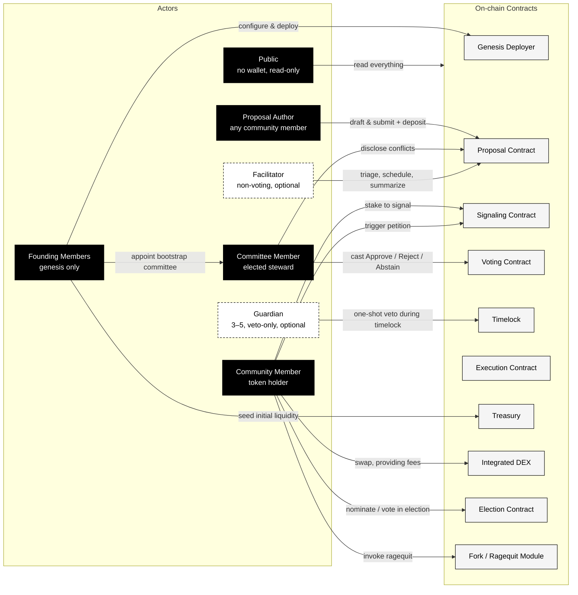
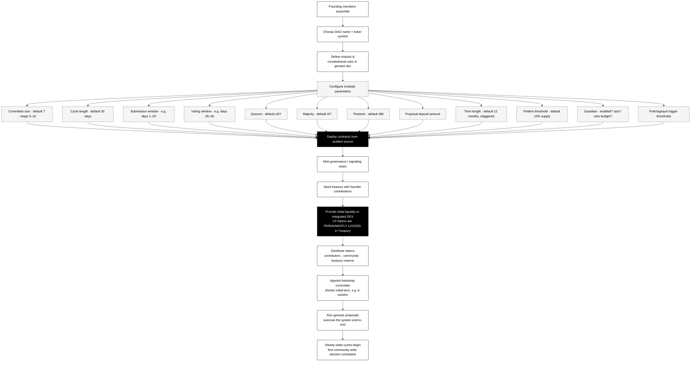
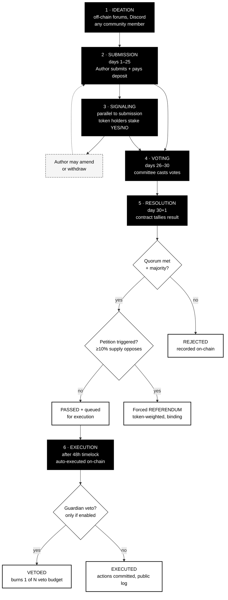
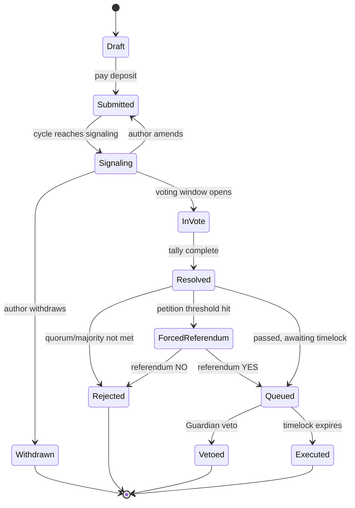
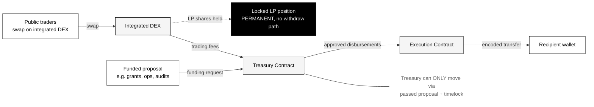
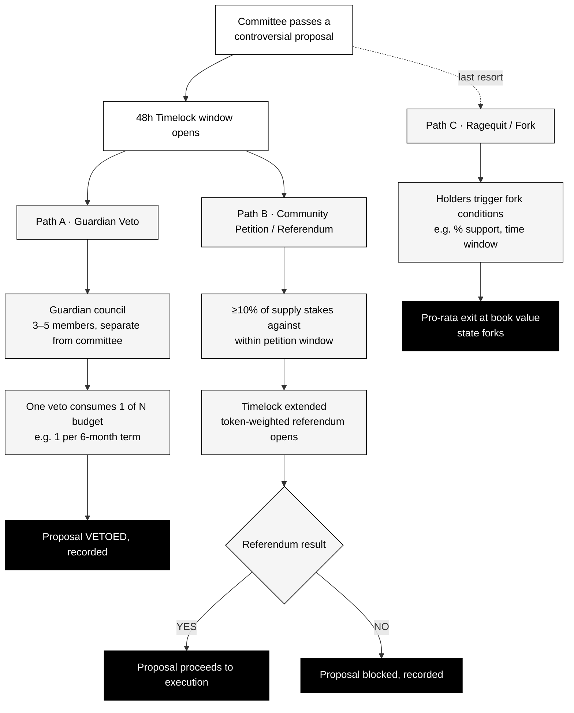
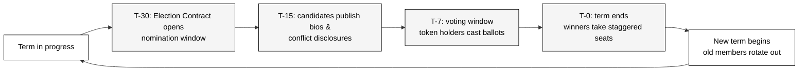

# 0xdx — Flows, Actors, and Inputs

This document maps every actor, every input, and every flow in the 0xdx framework. It is the visual companion to the [litepaper](../0xdx_litepaper.md). Defaults are stated; everything marked **configurable** can be set per-deployment in the genesis transaction.

---

## 1. Actors and what each can do

**Five voting / signaling rights, kept distinct:**

| Right | Who has it | Where |
|---|---|---|
| **Submit** a proposal | any community member (anti-spam deposit) | Proposal Contract |
| **Signal** sentiment | any token holder (stake-weighted, non-binding) | Signaling Contract |
| **Vote** on a proposal | committee members only (one-person-one-vote) | Voting Contract |
| **Veto** during timelock | Guardian (if enabled) | Timelock |
| **Override** via referendum | community supermajority (≥10% supply) | Petition mechanism |
| **Exit** via ragequit | any holder, under fork triggers | Fork Module |

---

## 2. Genesis — creating, naming, and launching a project

**Genesis inputs from founding members:**

- **Identity:** DAO name, ticker, mission statement, public website / contact.
- **Constitution:** all twelve modular parameters above.
- **Token plan:** total supply, distribution schedule, contributor allocations, treasury reserve %.
- **Capital:** initial liquidity contribution (paired token + base asset).
- **Bootstrap committee:** initial steward addresses + bios.
- **Optional roles:** whether Guardian is enabled and who serves; whether facilitators are funded.

---

## 3. Proposal lifecycle (single 30-day cycle)

**Per-stage inputs:**

| Stage | Actor | Input | Contract |
|---|---|---|---|
| Ideation | any community member | discussion text (off-chain) | — |
| Submission | proposal author | proposal body, requested funds, transactions, conflict disclosure, **deposit (paid)** | Proposal |
| Signaling | any token holder | stake amount + direction (YES/NO) | Signaling |
| Refinement | proposal author | amendment / withdrawal | Proposal |
| Voting | committee member | Approve / Reject / Abstain | Voting |
| Petition (parallel) | community | stake against in petition window | Signaling |
| Resolution | (automatic) | tally | Voting |
| Veto window | Guardian | one-shot veto | Timelock |
| Execution | (automatic) | encoded transactions fire | Execution |

---

## 4. Proposal state machine

---

## 5. Treasury and DEX flows

**Treasury inputs:**

- **In:** DEX trading fees (continuous), occasional grants/donations, optional token-sale tranches.
- **Out:** only via passed proposal → timelock → Execution Contract. No multisig backdoor, no off-chain "operations" budget.
- **Locked:** initial LP tokens are permanently held by the Treasury contract with no withdraw function. The DAO cannot rug itself.

---

## 6. Override and emergency paths

**Override hierarchy (highest authority last):**

1. Committee passes a proposal.
2. Guardian may veto (if enabled, narrow, budgeted).
3. Community may force a binding referendum (high bar, ≥10%).
4. Holders may ragequit / fork (last resort, guaranteed exit).

No layer above is mandatory — they are escape hatches, not routine governance.

---

## 7. Committee election cycle

**Election inputs:**

- **Candidate:** persistent identity (pseudonym OK, real-name OK), public bio, conflict-of-interest disclosure, optional nomination stake.
- **Voter:** any token holder; election uses configurable mechanism (default: stake-weighted with time-lock to deter Sybil; pure 1-token-1-vote is **not** the default).
- **Outcome:** top-N candidates take open seats. Seats are **staggered** so the whole committee never turns over in one cycle.

**Mid-term removal:** community-initiated recall vote, same threshold as a referendum, for cause (missed votes, undisclosed conflicts, demonstrable misconduct).

---

## 8. Modular configuration matrix

Every value below is set at genesis and changeable only via a constitutional proposal (higher quorum + extended timelock).

| Knob | Default | Range | Notes |
|---|---|---|---|
| Committee size | **7** | 1–∞ (5–15 recommended) | Smaller for early/small DAOs; larger for ecosystem-scale. **Size = 1** is legal (solo-operator DAO) — petition/referendum become primary check; Guardian strongly recommended. |
| Cycle length | 30 days | 7–90 days | Submission + signaling + voting fit inside one cycle. |
| Submission window | days 1–25 | configurable | Last 5 days reserved for voting. |
| Voting window | days 26–30 | configurable | No new submissions accepted. |
| Quorum (committee) | ≥5 of 7 voting | configurable | Members must show up. |
| Majority threshold | 4 of 7 (simple) | simple ↔ super | Some categories may require supermajority. |
| Timelock | 48h | 24h–7d | Longer for constitutional changes. |
| Proposal deposit | configurable | non-zero | Anti-spam; refunded on submission completion. |
| Term length | 12 months, staggered | 3–24 months | Bootstrap term often shorter (e.g. 6 mo). |
| Petition threshold | 10% of supply | 5–25% | Forces a binding token-weighted referendum. |
| Guardian | disabled | n/a | If enabled: 3–5 members, veto-only, budgeted (e.g. 1 per term). |
| Fork triggers | per deployment | n/a | % support + window + dispute resolution; documented in genesis. |
| Permanent liquidity lock | always on | — | LP tokens have no withdraw path. **Not** configurable. |

---

## 9. Threat model and edge-case audit

> This section is the framework's **canonical threat model**. It is named "edge cases and failure modes" historically, but reviewers should read §9 in this role: an exhaustive enumeration of attack surfaces, adversarial inputs, and degenerate scenarios — alongside the framework's response to each, and a status flag indicating how confidently that response is pinned.

This is the section the litepaper waves at. Every flow above has degenerate inputs and adversarial scenarios. Each row below lists the case, the framework's response, and a status flag:

- **✅ Specified** — explicitly covered in the litepaper or by an immutable contract rule.
- **🟡 Inferred** — implied by the design but not literally written down. Reference contract should make it explicit.
- **❌ Gap** — not addressed yet. Genesis deployers must decide; v1 contracts should pin a default.
- **🧪 Simulated** — verified via [`simulations/`](../simulations/SIMULATIONS.md). Default is pinned and reproducible.

### 9.1 Submission edge cases

| Case | Response | Status |
|---|---|---|
| Author submits on day 25 (last possible day) | Submission contract rejects writes within 24h of voting open — guarantees minimum signal time. | 🧪 Simulated [11] — `submissionCutoffBeforeVote=86400`. |
| Author submits then withdraws before voting | Deposit refunded with **20% slash to treasury**. Discourages submit-then-withdraw spam. | 🧪 Simulated [05] — `depositSlashBpsOnWithdraw=2000`. |
| Duplicate / near-duplicate proposals | No on-chain dedup. Facilitators flag duplicates publicly; the second is a wasted deposit. Committee may reject as redundant. | 🟡 Inferred. |
| Author loses keys after submitting | Proposal is locked to original author for amendment/withdrawal. If keys are lost, proposal proceeds untouched and committee votes on its merits. | 🟡 Inferred. |
| Author submits address that reverts on receive() | Execution fails atomically; proposal marked **Executed-Failed**, treasury funds remain locked, recipient can resubmit a fixed proposal. | 🧪 Simulated [09, 14] — atomic-revert preserves treasury. |
| Author submits proposal that exceeds treasury at submit time | Submission allowed (treasury may grow before execution); execution-time check applied. If still insufficient, marked **Executed-Failed**. | 🟡 Inferred. |
| Author submits a malformed transaction payload | Submission contract validates encoding at submit time and rejects malformed payloads. | ❌ Gap — define payload schema. |
| Cross-cycle proposal (long-running, multi-cycle) | Use **Revolving** category (litepaper §5.2). Renewal is a fast-track resubmission, not a new proposal. | ✅ Specified. |

### 9.2 Signaling edge cases

| Case | Response | Status |
|---|---|---|
| Whale signals 50% of supply | Visible in the ledger. Non-binding — committee may ignore or weigh as one input among many. Disclosed publicly. | ✅ Specified (signal is non-binding, public). |
| Token transferred mid-signal (double-signal) | Signaling stake **locks** tokens until the proposal resolves. Transfer attempts revert. | 🧪 Simulated [02] — `signalLockUntilResolved=true`. |
| Flash-loan signaling (1-block large stake) | Lock-on-stake makes flash loans uneconomic: lender repayment transfer reverts. | 🧪 Simulated [02] — verified end-to-end. |
| Signal is unstaked before voting | Permitted only after the signaling window closes. Within the window: locked. | ❌ Gap — define window-closes-at boundary. |
| Zero signal on a proposal | Committee proceeds to vote without community input. Recorded as "no signal" — not a failure, just a data point. | 🟡 Inferred. |
| Signal flips dramatically (heavy YES → heavy NO mid-window) | All transitions recorded; final state is what the committee sees at vote time. | 🟡 Inferred. |

### 9.3 Voting edge cases

| Case | Response | Status |
|---|---|---|
| Tied vote (e.g. 4-4 in an 8-seat committee) | Strict-greater majority: tie ⇒ **proposal fails** (status-quo bias). Configurable to "chair breaks tie" if a chair role is enabled. | 🧪 Simulated [03] — strict-greater rule. |
| Quorum not met (e.g. 3 of 7 vote) | Proposal fails by quorum, not by majority. Recorded distinctly so repeat-quorum failures can trigger committee accountability review. | ✅ Specified (litepaper §5.1). |
| Committee member misses vote (silent) | Counted as **non-vote**, not abstain. Counts against quorum. Repeated non-votes are grounds for recall (§8.2). | ✅ Specified. |
| Committee member is the proposal author | Must disclose conflict; recused from vote on that proposal. Their seat is effectively absent for quorum on that one item. | ✅ Specified (§8.2). |
| Committee member votes on a proposal that affects their pay | Recusal **mandatory**. Vote attempts on self-affecting proposals revert. Quorum computed against `committee.size − recusals`. | 🧪 Simulated [10] — `authorRecusalRequired=true`. |
| Committee member's wallet is compromised mid-cycle | Compromised votes are valid on-chain but can be challenged via mid-term recall. Recommend hardware-wallet + 2-key setup; not enforced. | 🟡 Inferred. |
| Committee member resigns mid-term | Seat opens; either filled by next-runner-up from last election, or held vacant until next election (set in genesis). | ❌ Gap — pick **next-runner-up** as default. |
| Committee member dies / disappears | After N consecutive missed votes (default 3), seat treated as resigned and filled per resignation rule. | ❌ Gap — define inactivity threshold. |
| Smart-wallet committee member (multisig / contract address) | Allowed iff EIP-1271 signature validation supported. Registered at election time. | ❌ Gap — pin EIP-1271 support in v1. |
| All members abstain | Counts as quorum but no majority → proposal fails. Recorded as committee-level abstention (potential signal of mis-scoped proposal). | 🟡 Inferred. |
| Committee votes against an audit finding (i.e. ships known-bad) | Voting record is public. No on-chain block; this is a reputational and recall mechanism. | 🟡 Inferred. |

### 9.4 Resolution & execution edge cases

| Case | Response | Status |
|---|---|---|
| Two passing proposals are mutually exclusive | Both queue; first to execute wins. Second fails atomically and is marked **Executed-Failed**. Recommended: add optional `dependsOn` field at submission to detect at queue time. | 🧪 Simulated [09] — atomic revert verified. |
| Treasury insufficient at execution time | Execution reverts; proposal **Executed-Failed**; can be resubmitted next cycle. | ✅ Specified (covered by atomic execution). |
| Recipient is now invalid (contract paused / address blacklisted) | Execution reverts; same handling. | ✅ Specified. |
| Network reorg invalidates execution | Execution Contract re-emits intent; replay protection ensures idempotency. | ❌ Gap — pin replay-protection rules in v1. |
| Execution gas estimate too low | Sender (Execution Contract) auto-retries with bumped gas up to a configurable cap. Beyond cap: marked failed. | ❌ Gap. |
| Proposal modifies governance parameters mid-cycle | Constitutional changes use **extended timelock** (default 7 days) and apply only to the **next** cycle, never the current one. | 🟡 Inferred — pin in v1. |

### 9.5 Petition / referendum edge cases

| Case | Response | Status |
|---|---|---|
| Petition reaches 9.99% (just under threshold) | No referendum triggered. Stake is released after timelock expires. | ✅ Specified. |
| Petition succeeds but tokens unstake before referendum | Petition stake is **locked** for the duration of the referendum, identical to signaling lock. | 🧪 Simulated [06] — lock-on-petition. |
| Referendum has below-minimum turnout | If turnout < 20% of supply, committee decision stands (proposal proceeds). Avoids tiny opposition blocking via petition+silence. | 🧪 Simulated [06] — `petitionMinTurnoutBps=2000`. |
| Referendum tie | Status-quo bias: ties favor blocking the original proposal (community sought a referendum, so default is "proposal blocked"). | ❌ Gap. |
| Two petitions on the same proposal | Only the first triggering petition counts; subsequent stakers join the same petition. | 🟡 Inferred. |
| Petition on a constitutional change | Constitutional changes auto-include extended community-vote window; petition is redundant but allowed. | ❌ Gap. |
| Petition stake exceeds 10% in last hour of window | Window does not extend; petition succeeds, referendum scheduled. | 🟡 Inferred. |

### 9.6 Guardian edge cases (only if Guardian is enabled)

| Case | Response | Status |
|---|---|---|
| Guardian budget exhausted, critical issue arises | No additional veto possible. Community must use referendum or fork. | ✅ Specified (budget is hard cap by design). |
| Guardian colludes with committee | No on-chain protection; community recall + fork are remedies. Reputational/social mechanism. | 🟡 Inferred. |
| Guardian veto on the wrong proposal (no undo) | Veto is final. Vetoed proposal can be resubmitted next cycle. Guardian member faces accountability via recall. | ✅ Specified. |
| Guardian quorum requirement | **Majority of Guardians** must sign veto (e.g. 2 of 3 for size-3). | 🧪 Simulated [07] — quorum enforced. |
| Single Guardian acts unilaterally | Single signature does **not** veto; remains queued. Quorum required. | 🧪 Simulated [07] — verified. |
| Veto budget unused at term end | Does not roll over. Resets each term. | 🧪 Simulated [07] — budget hard-cap. |
| Guardian member is also a token holder with stake in the outcome | Conflict disclosure required, same as committee. | 🟡 Inferred. |
| All Guardian seats vacant | Veto path disabled until elections refill seats. | ❌ Gap. |

### 9.7 Treasury & DEX edge cases

| Case | Response | Status |
|---|---|---|
| Zero DEX volume → no fees → treasury starves | Genesis reserve provides runway (recommend ≥12 cycles ≈ 1 year of ops at zero revenue). If revenue stays zero past runway, constitutional check forces a fund-or-windup vote. | 🧪 Simulated [12] — runway model. |
| DEX exploited (price oracle manipulation, reentrancy) | Audited integrated DEX is required. Bug bounty + monitoring. **No** unilateral pause — emergency pauses only via passed proposal + Guardian path. | ❌ Gap — define emergency pause path. |
| Treasury holds blacklisted stablecoin (e.g. USDC freezes an address) | Asset becomes inaccessible. DAO loses that portion. Diversification is the mitigation; not contract-enforced. | 🟡 Inferred. |
| Treasury asset depegs / collapses | Loss is realized. Treasury composition is configurable per proposal. | ✅ Specified. |
| Locked LP tokens become worthless | LP remains locked. The DAO does not get its initial capital back — that is the **point** of the permanent lock. | ✅ Specified. |
| Bridge failure (treasury holds wrapped assets) | Wrapped assets are at the bridge's mercy. Treasury policy should bias toward native assets. | 🟡 Inferred. |
| Reentrancy attack on Treasury during execution | Treasury MUST use checks-effects-interactions + reentrancy guards. Audited. | ❌ Gap — explicit in contract spec. |
| Token price crash makes proposal-deposit trivially cheap (spam vector) | Deposit denominated in **base asset** (e.g. ETH/USDC), not the DAO's own token. Stable cost regardless of governance-token price. | 🧪 Simulated [05] — `proposalDepositAsset='base'`. |

### 9.8 Election edge cases

| Case | Response | Status |
|---|---|---|
| Fewer candidates than seats | **Special election** scheduled to refill remaining seats. `leave-vacant` rejected: risks permanent quorum loss. | 🧪 Simulated [08] — `electionFallback='special-election'`. |
| Tied election (two candidates same vote count for last seat) | Tiebreaker: longer existing tenure wins; if both new, randomness derived from block hash. | ❌ Gap. |
| Same address wins two seats | Disallowed — one address, one seat. Tally enforces uniqueness. | 🧪 Simulated [08] — verified. |
| Whole committee turns over in one cycle | Staggering should prevent this. If staggering is bypassed (e.g. mass recall), a continuity clause: outgoing members serve a 7-day handover. | ❌ Gap. |
| Sybil attack on election | Pure 1-token-1-vote is **not** the default (litepaper §7.3). Default uses time-locked stake-weighted voting + nomination stake. | ✅ Specified. |
| No election held (election contract paused) | Existing committee continues with no legitimacy beyond term end. Anyone may call permissionless `triggerElection()` to force scheduling. | ❌ Gap. |
| Bootstrap committee refuses to schedule first election | First-election timestamp is set **at genesis** and is immutable. Election Contract self-triggers. | ❌ Gap — pin in v1. |
| Same person under two pseudonyms wins two seats | Cannot be detected on-chain. Reputational mechanism + community vetting. | 🟡 Inferred. |

### 9.9 Constitutional / fork edge cases

| Case | Response | Status |
|---|---|---|
| Fork triggered while proposals are mid-execution | In-flight proposals atomic-revert at fork point. Both forks inherit pre-fork treasury; new proposals are independent thereafter. | ❌ Gap — define fork point semantics. |
| Two simultaneous fork triggers | First to reach quorum wins; second is canceled. | ❌ Gap. |
| Constitutional amendment recursively requires itself to pass | Constitutional amendments use the extant rules (super-quorum + extended timelock) at the time of submission. Cannot be bypassed by amending the bypass rule first. | 🟡 Inferred — explicit in v1. |
| Critical bug in immutable contract | Reference deployment includes **migration helper** as the only upgrade path: full state-snapshot fork to a fresh deployment. Slow, deliberate, requires referendum. | ❌ Gap. |
| Frontend host disappears | Repository is open source; community can run their own frontend. Litepaper and contracts are sufficient. | ✅ Specified (open source + on-chain). |
| Permanent lock contradicted by a "smart" upgrade | Lock function has **no caller-allowed-to-unlock** code path. Not configurable. | ✅ Specified. |

### 9.10 Identity & timing edge cases

| Case | Response | Status |
|---|---|---|
| Pseudonymous member doxxed mid-term | No on-chain effect. Member may resign; no automatic removal. | 🟡 Inferred. |
| Two committee members are the same person (Sybil committee) | Cannot detect on-chain; reputational + vetting. Election design with nomination stakes raises the cost. | 🟡 Inferred. |
| Block-time variance shifts cycle by hours | Cycle uses **block timestamps**, not block counts. Cycle boundaries are wall-clock approximate; voting/signaling windows are explicit timestamps. | ❌ Gap — pin timestamp-based cycles. |
| Chain halt during voting window | Voting window is wall-clock; if chain halts, votes after restart are still valid as long as the timestamp is within the window. Resolution gracefully handles missed quorum. | 🟡 Inferred. |
| DST / timezone confusion in published windows | All timestamps are UTC, on-chain. UI converts. | ✅ Specified. |
| Long chain reorg invalidates votes | Forward-only state transitions: re-execute is a no-op. Voting Contract should emit vote-finalized event after a confirmation depth (e.g. 12 blocks). | 🧪 Simulated [15] — replay no-op verified. |
| Committee member's geographic legal status changes | Out of scope. Pseudonymity preserves participation. | ✅ Specified. |

### 9.11 Smart-contract integrity & social-attack edge cases

These four classes were added in the v1.0 audit pass. Each maps to a real-world incident or published attack class. Where the response is "contract-level invariant", v1 reference contracts must encode it.

| Case | Response | Status |
|---|---|---|
| **Proposal description / code mismatch** (Beanstalk-class). Proposal's human-readable description claims one thing; executable calldata does another. | Reference contract requires a description hash committed at submission and re-verified at execution; mismatch reverts. UIs must display decoded calldata alongside description. Front-ends that hide calldata are non-compliant. | ❌ Gap → v1 contract requirement. |
| **Privileged function backdoor**. Governance contract has admin-set parameters (`setVotingPeriod`, `setProposalThreshold`, `setQuorum`) callable by an EOA, allowing developer to silently change rules. | Contract-level invariant: every parameter-mutating function is gated by `onlyGovernance`. There is no admin EOA. The threat model treats any deployment with an admin override as non-compliant. | ❌ Gap → v1 contract invariant. |
| **CREATE2 / contract redeployment attack**. Governance contract deployed via CREATE2 is self-destructed and redeployed at the same address with different bytecode. | Reference contract is deployed via CREATE (not CREATE2), or — if CREATE2 is required for cross-chain address consistency — the constructor self-destructs the SELFDESTRUCT opcode path. Bytecode hash of the deployed governance contract is published in the genesis declaration and verifiable against on-chain bytecode. | ❌ Gap → v1 contract requirement. |
| **Committee bribery**. A wealthy outsider offers committee members payment to vote a specific way. Vote-buying is hard to detect and impossible to prove on-chain. | Layered mitigations: (a) `authorRecusalRequired=true` removes the most direct conflict; (b) public voting record creates social cost; (c) shrunken-vote-window + Guardian veto creates time for community response; (d) committee recall procedure exists. The framework does **not** claim to solve bribery; it claims to make routine bribery socially expensive and time-bounded. | 🟡 Inferred — name explicitly in v1 spec. |
| **Coercion of voters / committee members**. A participant is physically coerced into voting a specific way. ZK proofs do not prevent this. | v1 explicitly does **not** offer receipt-freeness. Acknowledged in `IDENTITY.md` §7 as a known limit and an open research area (Civitas, MACI). | ✅ Specified — acknowledged limit. |
| **Front-end / UI hijack**. Hosted front-end serves a malicious version that misrepresents proposals or harvests credentials. | Reference deployment serves an IPFS-pinned front-end with a published content hash referenced from the canonical contract. Wallet-side warning if hash mismatch. Browser extension or local-host build is the trust-minimized path. | ❌ Gap → deployment-level requirement. |

### 9.12 Failure-mode summary

The framework's behavior under stress, in priority order:

1. **Stop the bleed.** All write paths are timelocked. Time is the universal escape valve.
2. **Preserve the vote record.** Even when execution fails, the voting record is preserved on-chain — accountability survives bad outcomes.
3. **Refund where possible.** Failed executions return funds atomically. The treasury cannot be partially drained by a half-finished proposal.
4. **Make the override possible.** Petition + Guardian + fork mean no single failure mode is unrecoverable.
5. **Document the gap.** Where this section says ❌ Gap, the v1 reference contracts must pin a concrete default and the litepaper must reflect it.

Open gaps marked ❌ above are the **v1 contract specification work-list** — items that need a default before any deployment is safe.

---

## 10. Read paths (no wallet required)

Everything in 0xdx is auditable without participating:

| What | Where | Format |
|---|---|---|
| Live and historical proposals | Proposal contract events | indexed, searchable |
| Committee voting record | Voting contract events | per-member, per-proposal |
| Treasury balance & flows | Treasury contract state | continuous |
| Signaling totals | Signaling contract state | per-proposal |
| Election results | Election contract events | per-cycle |
| Guardian veto log | Timelock events | running counter |
| Constitutional parameters | genesis transaction + amendments | immutable history |
| Meeting minutes | published by facilitators | signed, public |

Public, by construction.
